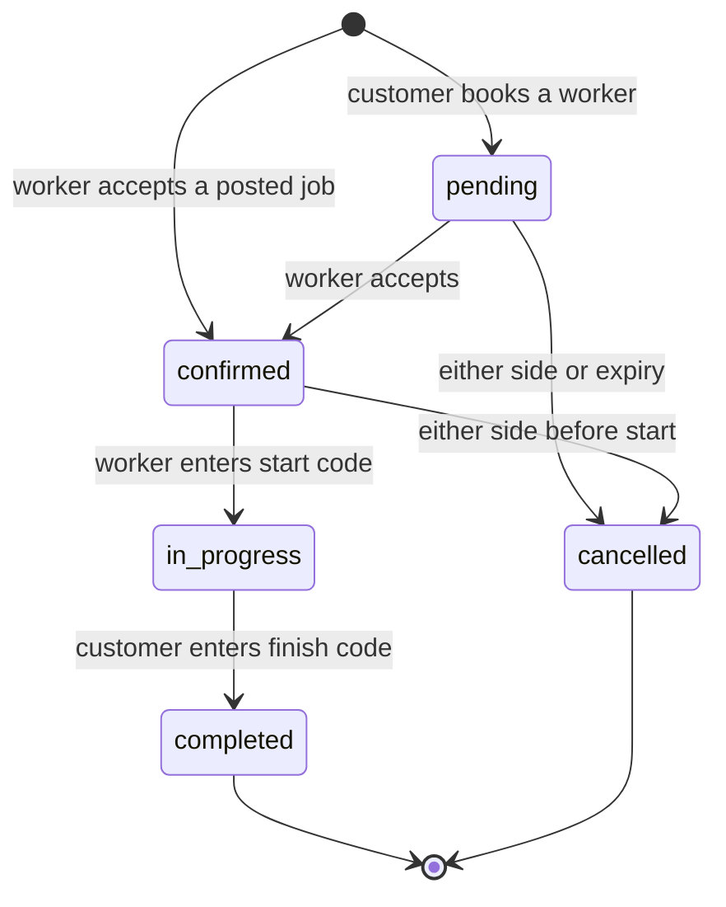
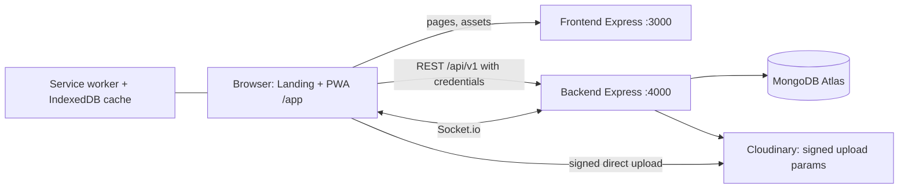

# WorkCred: Complete Project Plan

**Tagline:** Proof of work, work near you.
**Version:** 2.0 (local build) · **Date:** 11 Oct 2026
**Document type:** Product Requirements (PRD) + Technical Plan

---

## 1. Product Overview

### 1.1 One-line pitch
WorkCred is a mobile-first web app where daily-wage workers build a verified work history and get hired nearby at fair prices, and customers find trusted help fast, with cash paid directly and no middleman.

### 1.2 The problem
| Who | Pain |
|---|---|
| Workers (helpers, electricians, plumbers, masons, painters, cooks, cleaners, drivers, vendors) | No proof of past work, so every new customer starts from zero. Idle hours lose income. They do not know what to charge. Middlemen and unreliable apps take a cut. |
| Customers (households, shops, small contractors) | Hard to find trustworthy help quickly. No way to check a worker's real history. Prices are opaque. No-shows are common. |
| Both | Cash jobs have no evidence of who showed up, how long they worked, or whether the job was finished. |

### 1.3 The solution
1. **Verified work records.** A job is recorded only when both people complete a two-code handshake (a start code and a finish code). Each record is added to the worker's **Work Passport**, a tamper-evident history.
2. **Real-time availability.** Workers tap "I'm Free Now" for 2, 4 or 8 hours and nearby customers see them instantly.
3. **Price transparency.** The **Fair Rate Compass** shows the normal price range for a skill in an area.
4. **Simple cash flow.** The app handles matching, scheduling and proof. Money is paid in cash after the job, so there is no wallet, no commission and no payment gateway.
5. **Light community layer.** A nearby feed with work photos, follow/save and skill endorsements, with no chat and no public comments.

### 1.4 Scope of this version
- Runs entirely on one computer (localhost), with the database on MongoDB Atlas (free tier) and photos on Cloudinary.
- Built as two separate Express servers: a frontend server and a backend API server.
- Private by default: all worker and customer information is visible only to logged-in users inside the app. There are no public profile pages and no external sharing in this version.

### 1.5 Vision and value
| For workers | For customers |
|---|---|
| Portable proof of work and rating | Hire with evidence, not guesses |
| More paid hours through Free Now | Find help within minutes |
| Know a fair price before bidding | See the fair price before booking |
| Keep 100% of cash earned | Pay the worker directly, no surcharge |

---

## 2. Users and Personas

| Persona | Description | Main goals | Constraints |
|---|---|---|---|
| **Worker: Ravi, 34, electrician** | Low-end Android phone, patchy mobile data, uses simple English or his regional language | Get steady jobs nearby, show a track record, charge fairly | Limited typing, small screen, may be outdoors in bright light |
| **Worker: Lakshmi, 41, domestic helper** | Shares a phone with family, works several homes | Get regular bookings, prove reliability | Time-poor, needs very simple flows |
| **Customer: Meera, 29, working professional** | Smartphone user, books help for home repairs | Find a trusted electrician or helper fast | Worried about safety and being overcharged |
| **Customer: Imran, 45, small shop owner** | Needs 2 helpers for a few hours at short notice | Fill urgent shifts quickly | Needs Free Now and quick booking |
| **Support/Admin (developer only)** | Maintains the system | Reset a password, unlock an account, review flagged items | Uses scripts, not a UI, in this version |

---

## 3. Goals, Non-Goals and Success Measures

### 3.1 Goals
1. A worker can sign up and be ready for work in under 3 minutes.
2. A customer can find a worker and send a booking request in under 2 minutes.
3. Every completed job produces exactly one tamper-evident Passport record.
4. A cash job can be completed with clear evidence of who was present and for how long.
5. Works on low-end phones and weak networks, and installs as an app from the browser.
6. Private data (phone numbers, exact locations, codes) is released only when needed.

### 3.2 Non-goals for this version
Online payments or wallets, chat, public profile pages, external sharing, video, a map view, admin dashboards, real SMS or email, multiple languages (the UI is in plain English with all strings in one file so other languages can be added later), and cloud hosting.

### 3.3 Success measures (how we will judge the project)
| Area | Measure |
|---|---|
| Core flow | A full journey (sign up, search, book, confirm, start code, finish code, receipt, Passport entry) works end to end in a demo in under 7 minutes |
| Integrity | Changing any stored record is detected by the integrity check 100% of the time in tests |
| Concurrency | Parallel tests show no double-booking, no oversold jobs and no more than 5 code attempts counted |
| Performance | Lighthouse mobile: Performance 90+, Accessibility 95+, Best Practices 95+ on main screens (Slow 4G, 4x CPU) |
| Quality | All automated tests pass (unit, backend, end-to-end, accessibility); zero Critical or High security findings open |
| Honesty | The app and docs make no claim that is not true of the build (no invented statistics, testimonials or verification claims) |

---

## 4. Product Principles
1. **Trust comes from evidence, not claims.** Proof is created by the handshake, not typed in by users.
2. **Simple English, one action per screen.** Short words ("Find Worker", "I'm Free", "Job Done", "Paid Cash"), icon plus label on every button, 16 px minimum text, 48 px minimum tap targets.
3. **Cash-first.** The app never touches money.
4. **Private by default.** Phone numbers, exact locations and booking codes are shown only to the right person at the right time.
5. **Calm, human design.** Warm and professional, not flashy. Meaning is never shown by color alone.
6. **Works on weak phones and networks.** Small JavaScript, cached screens, clear offline states.
7. **Honest by design.** Sample data is labeled as sample. Limitations are documented.

---

## 5. Roles and Permissions

Role is chosen at sign-up and cannot be changed. `admin` is never created through the app.

| Capability | Visitor | Customer | Worker |
|---|---|---|---|
| View landing, privacy, terms | ✔ | ✔ | ✔ |
| Sign up, log in | ✔ | n/a | n/a |
| Search workers, view profiles and Passport history | ✘ | ✔ | ✔ (view only) |
| Post jobs, book workers, finish jobs with the finish code, rate, endorse | ✘ | ✔ | ✘ |
| See open jobs, accept jobs, confirm requests, enter start code, go Free Now | ✘ | ✘ | ✔ |
| Create work posts, manage Passport privacy, edit skills, rate and calendar | ✘ | ✘ | ✔ |
| Save, follow, report, feed, change password | ✘ | ✔ | ✔ |

---

## 6. Features and Functional Requirements

Priority: **M** = must have (MVP), **S** = should have, **L** = later (Phase 2).

### 6.1 Authentication and accounts (M)
| ID | Requirement |
|---|---|
| AUTH-1 | **Sign up** with role (worker or customer), name, 10-digit Indian mobile number and password. The number must be unique. |
| AUTH-2 | **Log in** with phone number and password using role tabs (Worker, Customer). The role is checked only after the password is verified. A mismatched role returns a clear message and no session. |
| AUTH-3 | **Password rules:** 8 to 64 characters, not a common password, not the phone number, not the name, no repeated or sequential patterns. Passwords are hashed with scrypt and per-user salt, never stored or logged in plain form. |
| AUTH-4 | **Brute-force protection:** after 5 wrong passwords the account locks for 10 minutes (doubling up to 1 hour). Per-IP limits on sign-up and login. Responses for unknown phone and wrong password are identical. |
| AUTH-5 | **Sessions:** 15-minute access token held in memory only, plus a rotating 30-day refresh cookie (httpOnly, SameSite). Reuse of an old refresh token revokes that login. Silent refresh keeps users logged in. |
| AUTH-6 | **Change password** (needs the current password). All other devices are logged out. |
| AUTH-7 | **Log out** revokes the session and clears cached data. Other open tabs also log out. |
| AUTH-8 | **Password reset** is handled by support through a script (no email or SMS in this version). The login screen says so plainly. |
| AUTH-9 | Disabled accounts cannot log in or keep a session. |

### 6.2 Onboarding and profiles (M)
| ID | Requirement |
|---|---|
| PROF-1 | **Worker onboarding:** name, optional photo, 1 to 6 skills (one marked main), rate per hour or day, area (from a list or "Use my location"), job-search radius (1 to 10 km), short bio (200 characters). |
| PROF-2 | **Customer onboarding:** name and area. |
| PROF-3 | Skills list: helper, electrician, plumber, mason, painter, carpenter, cook, cleaner, driver, vendor, other. |
| PROF-4 | **Availability calendar** for workers: weekly pattern (Off, Morning, Afternoon, Evening, Full day per weekday) plus blocked dates. Customers cannot book blocked slots. |
| PROF-5 | Profile photos are compressed in the browser and uploaded directly to Cloudinary with a server-signed request. |
| PROF-6 | A profile is "complete" when the required fields are set. Incomplete profiles are routed back to onboarding. |

### 6.3 Find workers (M)
| ID | Requirement |
|---|---|
| FIND-1 | Search by skill, distance (1 to 10 km), price range (per hour or per day), minimum rating. Sort by nearest, top rated or lowest price. |
| FIND-2 | Worker cards show photo or initials, name, main skill, rating and job count, **approximate** distance ("about 1 km"), rate with a Fair/Low/High chip, a "Has verified history" badge (when the worker has Passport records) and a "Free now" badge when live. |
| FIND-3 | Filters are kept in the URL so back and refresh work. Results use cursor pagination with no duplicates. |
| FIND-4 | Phone numbers and exact coordinates are never returned in search results. |

### 6.4 Worker profile (M)
| ID | Requirement |
|---|---|
| WPRO-1 | Shows bio, skills, rate, stats (jobs, rating, hours), a seven-day availability summary and endorsement counts per skill. |
| WPRO-2 | Shows the worker's **visible Passport records** (see 6.8) with the integrity check result ("History checked: Valid, N records"). |
| WPRO-3 | Actions: Book, Save, Follow, Endorse (only after a completed job with that worker for that skill), Report. |
| WPRO-4 | The phone number is not shown. A **Call** button appears only on a confirmed or in-progress booking. |

### 6.5 Jobs (M)
| ID | Requirement |
|---|---|
| JOB-1 | A customer posts a job: skill, workers needed (1 to 10), hours (1 to 12), start date and time (future, within 30 days), offered rate per worker, description (300 characters), location. |
| JOB-2 | While posting, the customer sees the **Fair Price hint** (Low, Fair or High) from the Compass. |
| JOB-3 | Nearby workers with a matching skill see the job in **Jobs near you** with approximate distance, pay, spots left and start time. |
| JOB-4 | A worker accepts a job. Slot counting is atomic, so a job with 2 slots can never get 3 workers. When full the job becomes "filled". |
| JOB-5 | A worker cannot accept overlapping work or work on a blocked day. |
| JOB-6 | A customer can cancel a job. Bookings that have not started are cancelled and workers are notified. |
| JOB-7 | Jobs expire after their start time. |

### 6.6 Direct booking (M)
| ID | Requirement |
|---|---|
| BOOK-1 | A customer books a specific worker: date, time, hours (1 to 12), optional note (200 characters). The booking starts as **pending**. |
| BOOK-2 | The worker accepts (confirmed) or declines. Pending bookings also block the worker's time so two customers cannot grab the same slot. |
| BOOK-3 | Booking requests from the Free Now list start in 30 minutes by default. |
| BOOK-4 | Captions, notes and descriptions cannot contain phone numbers or links (including disguised forms). |
| BOOK-5 | Submitting twice (slow network, double tap) never creates two bookings (idempotency key). |

### 6.7 Handshake and cash payment (M), the core trust feature
| ID | Requirement |
|---|---|
| HAND-1 | Each booking gets a 4-digit **start code** and a 4-digit **finish code** at creation, stored encrypted. Only the customer can see them, and only while the booking is confirmed or in progress. They are hidden until tapped and auto-hide after 30 seconds. |
| HAND-2 | **Start:** the worker arrives, asks the customer for the start code and enters it (with optional location). The booking becomes **in progress** and the start time is recorded. A soft warning is shown if the worker is more than 500 m from the job location. |
| HAND-3 | **Finish:** the customer enters the finish code, confirms "I paid cash" and rates the worker from 1 to 5 with an optional comment. The booking becomes **completed**. |
| HAND-4 | Five wrong code attempts lock that step for 10 minutes. Attempt counting is atomic. |
| HAND-5 | Finishing runs in one database transaction: it completes the booking, creates the Passport record and updates the worker's stats. After that the Compass data is recomputed. |
| HAND-6 | Bookings can be cancelled by either side only before the start. Repeated worker cancellations are counted and warned about. |
| HAND-7 | **Receipt** for both sides: date, times, hours, cash amount, rating and the new Record ID. |
| HAND-8 | The worker's phone number and the exact job location are released to the other side only when the booking is confirmed. |
| HAND-9 | "Report a problem" lets a worker flag an issue during a job (stored for support). |

### 6.8 Work Passport (M), in-app verified history
| ID | Requirement |
|---|---|
| PASS-1 | Each completed job adds exactly one **Passport record**: skill, date, hours, rating, comment, employer display name, Record ID. |
| PASS-2 | Records are **append-only**. Nothing in the app can edit or delete a record. Workers can only change two things per record: whether it is **visible to customers**, and whether the **employer name is shown or masked** (default masked, for example "R*** K."). |
| PASS-3 | Records are chained: each record's fingerprint includes the previous one. The system also stores the latest record number and fingerprint on the worker, so deleted tail records are detected. |
| PASS-4 | **Integrity check:** recomputes the full chain, including private records, and reports "Valid, N records" or "Needs attention" without exposing any fingerprints. |
| PASS-5 | Worker's **Passport tab**: stats, skill counts, full timeline (including hidden records), privacy controls, integrity strip, and a "Show or hide" summary ("12 shown, 2 hidden"). New workers see a friendly empty state. |
| PASS-6 | Customers see only visible records on the worker profile, with masked employer names and a note such as "2 private records are included in the check". |
| PASS-7 | The language is plain English ("History checked", "Valid", "Records checked"). No technical jargon such as blockchain, crypto or hash appears in the UI. |

### 6.9 Free Now Radar (M)
| ID | Requirement |
|---|---|
| FREE-1 | A worker taps **I'm Free Now** and picks 2, 4 or 8 hours. One live window per worker. The card shows a countdown, Extend (up to 12 hours total) and Stop. |
| FREE-2 | Customers see a distance-sorted list of workers free within 3 km (up to 5 km) with minutes left, rate, rating and a **Book now** button. |
| FREE-3 | Lists update live when workers go free or get booked. If the live connection drops, the list refreshes every 30 seconds. |
| FREE-4 | Expired windows disappear immediately (read-time check), not when the database cleanup runs. |
| FREE-5 | A worker with a job in progress cannot go Free Now. Booking a free worker or starting a job closes the window. |

### 6.10 Fair Rate Compass (M)
| ID | Requirement |
|---|---|
| COMP-1 | Shows the 25th percentile, median and 75th percentile price per skill per area (per hour or per day) from completed jobs of the last 90 days. |
| COMP-2 | If fewer than 5 samples exist, it falls back to the city, then to sample baseline data, and says "Based on sample rates for now". |
| COMP-3 | Appears on Post Job, the worker's rate editor, worker cards and the booking sheet as a Low, Fair or High bar with an icon and label. |

### 6.11 Feed, posts, follow and endorse (S)
| ID | Requirement |
|---|---|
| FEED-1 | One feed screen for both roles. Workers see nearby open jobs and work posts. Customers see free workers and work posts. Both see posts from followed workers. Cursor pagination, no duplicates. |
| FEED-2 | **Work posts:** an after photo (required), an optional before photo, skill, caption (140 characters) and an optional link to a completed job (shows a "Verified job" badge). Limits: 10 posts per day. |
| FEED-3 | **Follow and Save** workers. Lists with undo. |
| FEED-4 | **Endorse** a worker's skill once, only after a completed job for that skill. |
| FEED-5 | **Report** a post or worker. Reports are stored only, with duplicate suppression and rate limits. |
| FEED-6 | There is no chat, no public comments and no likes. Contact happens through the Call button after confirmation. |

### 6.12 Realtime (M)
Live updates for Free Now, new jobs, booking requests, confirmations, start, completion and cancellations (see section 14).

### 6.13 Offline and install (S)
Installable PWA. App shell works offline. Whitelisted screens (profile, lists, Passport, feed) show a "Saved copy from {time}" banner. Actions that need a live connection are disabled with a plain message. Only save and follow actions are queued offline. Booking codes are never cached.

### 6.14 Landing page (M)
A public marketing page that opens first at `/`. See section 9.

### 6.15 Phase 2 (L)
| Feature | Idea |
|---|---|
| Phone verification | Optional OTP "verify my number" step |
| Password reset | Self-service by SMS or email |
| Income Proof Statement | A private PDF of verified earnings for loans and rent (needs a safe way to prove it is genuine) |
| Squad Jobs | Book a crew as one unit, split payout |
| Skill Levels | Beginner, Trusted, Expert from completed jobs and endorsements |
| Push notifications | Real background alerts |
| More languages | Regional language UI |
| Admin console | Review reports and flagged items |
| Hosting | Move from localhost to the cloud |

---

## 7. User Flows

### 7.1 Customer journey
1. Landing page → **Sign up** as a customer → onboarding (name, area).
2. **Find** workers, or open **Free Now**, or **Post a job** (with the Fair Price hint).
3. Open a worker profile, check their history, **Book**.
4. The worker confirms. The booking detail now shows the worker's phone, the exact job location and the codes.
5. On the day the worker arrives and the customer reads out the **start code**.
6. When done the customer enters the **finish code**, confirms "I paid cash" and rates.
7. Receipt appears and the Passport gains a record. The customer can endorse the worker.

### 7.2 Worker journey
1. Landing page → **Sign up** as a worker → onboarding (skills, rate, area).
2. **Home:** tap I'm Free Now, answer booking requests, or accept jobs near you.
3. **My Work:** see confirmed jobs. On arrival tap "I've arrived" and enter the customer's start code.
4. Do the job. The customer finishes it.
5. See "Job done, ₹X earned" and the new record in the **Passport** tab. Adjust privacy.
6. Share work photos in **Post** and keep the calendar and rate current in **Me**.

### 7.3 Booking state diagram


---

## 8. Screen Inventory

### 8.1 Public
Landing (`/`), Sign up, Log in, Privacy, Terms, Grievance (drafts for legal review).

### 8.2 Shared (logged in)
Onboarding, Feed, Account (profile summary, edit, change password, log out), Report sheet, 404, Offline and error states.

### 8.3 Customer app (bottom tabs: Find · Free Now · Post Job · Bookings · Saved)
| Screen | Notes |
|---|---|
| Find, Filters sheet, Locality picker | Search and sort |
| Worker profile | Passport preview, integrity badge, Book, Save, Follow, Endorse |
| Booking sheet | Day and time chips, hours, price summary, Compass bar |
| Free Now | Live list with Book now |
| Post Job | Form, Fair Price card, review, success |
| Bookings | Tabs: Upcoming, Active, Done, plus My jobs |
| Booking detail | Timeline, codes (tap to reveal), Call, cancel |
| Finish sheet | Code, paid cash, rating, comment |
| Receipt | Summary and Record ID |
| Saved | Saved and Following tabs |

### 8.4 Worker app (bottom tabs: Home · My Work · Passport · Post · Me)
| Screen | Notes |
|---|---|
| Home | Free Now card, "Needs your answer" requests, Jobs near you |
| Job detail sheet | Accept job |
| My Work | Tabs: Requests, Upcoming, Active, Done |
| Booking detail | Timeline, Call, directions after confirmation, cash to collect |
| Start code sheet | Four boxes, location check, attempts left |
| Active job view | Timer, Report a problem |
| Completion sheet and Receipt | Earnings and new record |
| Passport | Stats, timeline, privacy toggles, integrity strip, entry detail sheet |
| Post | Create work post, My posts |
| Me | Profile, skills, rate editor with Compass, calendar and blocked dates, radius, account |

---

## 9. Design and UX

### 9.1 Design system: "WorkCred Warm"
| Element | Rule |
|---|---|
| Canvas | Warm cream pages, slightly deeper cream bands for alternate sections |
| Dark surfaces | Espresso brown-black for emphasis sections and the footer |
| Accent | Terracotta for primary buttons, eyebrow labels and one italic accent word per headline |
| Status | Forest green for live, success and verified, always with an icon and label. Amber for caution, red for errors |
| Type | Serif display headings (large, tight, italic accent word) with a clean sans-serif for body and UI. Self-hosted fonts |
| Shape | Hairline borders, soft radius (about 24 px cards, 16 px inputs, pill buttons), few shadows |
| Navigation | Floating pill bottom tab bar on mobile with icon and label |
| Tokens | All colors, sizes, spacing and motion live in one `tokens.css`. No hard-coded values elsewhere (enforced by a lint script) |

### 9.2 Accessibility and usability rules
48 px tap targets, 16 px minimum body text, 13 px minimum labels, WCAG AA contrast, visible focus rings, keyboard operable everything, focus moves to the page heading on every route change, sheets trap focus and restore it, screen-reader announcements for live changes (polite), works at 200% zoom and with 30% longer text, respects reduced motion and data saver.

### 9.3 Simple English guide
One action per screen. Plain verbs: Find Worker, I'm Free, Job Done, Paid Cash. Errors say what to do next ("Wrong code. 3 tries left."). Prices in rupees with Indian digit grouping. Times like "Today 4 PM". Distances like "about 1 km". All strings live in one file.

### 9.4 Landing page plan
| Section | Content |
|---|---|
| Top bar | Logo, nav (How it works, For workers, For families), Log in, Sign up |
| Hero | Large headline "Proof of work, work near you." with an italic accent, supporting line, two CTAs (I want work → worker sign-up, I need a worker → customer sign-up), a candid photo of a worker with a floating sample Passport card and a "Free Now" chip (labelled "Sample") |
| Problem | One strong statement about reputation living in one person's memory |
| How it works | Three steps: post or find a job, meet and enter the start code, finish and get paid cash while the record is added |
| Work Passport | A sample worker history with the "Valid" badge |
| Bento features | Fair Rate Compass, Free-Now Radar, Handshake codes, Nearby feed |
| Two sides | Workers and customers, three short lines each |
| Final CTA and footer | Sign-up buttons, links to Privacy, Terms, Grievance |
| Rules | No invented statistics or testimonials. Sample data is labelled. Content is visible without JavaScript. |
| Motion | Progressive enhancement: line reveals, counters, staggered cards, parallax on desktop. Lightweight CSS and IntersectionObserver on mobile. Everything respects reduced motion. |

---

## 10. System Architecture

### 10.1 Two separate Express servers
| | Frontend server | Backend server |
|---|---|---|
| Address | `http://localhost:3000` | `http://localhost:4000` |
| Role | Serves the landing page, `/app` (single-page app), static assets, shared rule modules and `/config.js` | REST API at `/api/v1` and the Socket.io server |
| Stack | Express, helmet, compression | Express, Mongoose, Socket.io and security middleware |
| Data | None | MongoDB Atlas, Cloudinary |

The browser loads pages from port 3000 and calls the API on port 4000 directly with credentials. The frontend server generates `/config.js` from the hostname the browser used, so the page and the API always share the same hostname. Browsers treat `localhost:3000` and `localhost:4000` as the same site, so the refresh cookie works. Mixing `localhost` and `127.0.0.1` in one session would break it, so a session belongs to one of them.



### 10.2 Backend structure (modular monolith)
Routes → Controllers → Services → Models → MongoDB. Business rules live in services and in a shared folder of pure modules (state machine, hash chain, Compass math, geo helpers, validators, password rules) that both the mock and the real backend use, so they cannot drift.

### 10.3 Phased build approach
The frontend is built first against a **mock API** that returns the exact response format of the real backend. The backend is then built to the same contract and the two are integrated by flipping one switch. Contract tests run the same scenarios against both.

---

## 11. Technology Stack

| Layer | Technology | Why |
|---|---|---|
| Frontend | HTML, CSS, vanilla JavaScript (ES modules) | Required stack, tiny bundles for low-end phones, no build step |
| Frontend server | Node.js 20 + Express + helmet + compression | Simple static hosting with security headers and CSP |
| Backend | Node.js 20 + Express 4 | Required stack, mature middleware |
| Database | MongoDB Atlas (free M0) + Mongoose 8 | Required stack, geo queries, TTL indexes, transactions |
| Authentication | Phone + password (scrypt via `node:crypto`), JWT access token (`jose`), rotating refresh cookie | Passwordless OTP replaced by passwords. No extra services |
| Real-time | Socket.io | Free Now and booking updates with reconnection |
| Media | Cloudinary (signed direct uploads, no SDK) | Offloads image storage and optimization |
| Offline | Service worker + IndexedDB | PWA install and cached screens |
| Security libraries | helmet, cors, cookie-parser, express-rate-limit, express-mongo-sanitize | Hardening |
| Logging | pino (JSON) with a small readable development formatter | Structured logs with secrets masked |
| Validation | Shared hand-written validators used by both the mock and the backend | One set of rules |
| Testing | `node:test`, mongodb-memory-server, Playwright and axe-core (dev only) | Unit, integration, end-to-end and accessibility checks |
| Tooling | ESLint, Prettier, a token lint script, a local launcher script | Quality and one-command start |
| Deployment | None. Local only (localhost) | Your requirement |

---

## 12. Data Model (MongoDB)

All IDs are ObjectIds. Geo fields are GeoJSON points `[lng, lat]`.

| Collection | Purpose | Key fields | Indexes and constraints |
|---|---|---|---|
| **users** | Customers and workers | role (fixed), name, phone, passwordHash (hidden), failedLoginCount, lockUntil, lockLevel, mustChangePassword, lastLoginAt, photoUrl, location, localityKey, isActive; worker fields: skills (one main), hourlyRate, dailyRate, bio, radiusKm, calendar {weekly, blockedDates}, passportStats {jobs, avgRating, totalHours, topSkills}, passportHead {seq, hash}, defaultMaskEmployerNames, penalty counters, profileComplete | unique phone; 2dsphere location; {role, isActive, skills}; {role, passportStats.avgRating} |
| **refreshTokens** | Login sessions | userId, familyId, tokenHash, usedAt, replacedByHash, revokedAt, expiresAt | unique tokenHash; TTL on expiresAt |
| **jobs** | Posted jobs | customerId, skill, workersNeeded, acceptedCount, hours, startAt, offeredRate, description, location, status | 2dsphere; {status, skill, startAt} |
| **bookings** | One worker per booking | jobId?, customerId, workerId, skill, agreedRate, scheduledAt, hours, status, startCodeEnc and finishCodeEnc (encrypted, hidden), attempt counters and lock times, startedAt, startedGeo, farFromJob, finishedAt, hoursWorked, paidCash, rating, comment, source (job, direct, freenow), location copy, cancelledBy, flags | {workerId, status, scheduledAt}; {customerId, status, scheduledAt}; unique active {jobId, workerId} |
| **passportEntries** | Append-only work history | workerId, bookingId, seq, skill, date, hours, rating, comment, employerDisplay {name, masked}, visible, prevHash, hash | unique bookingId; unique {workerId, seq}. Only `visible` and the mask flag can ever change |
| **availability** | Free Now windows | workerId, location, skills, rate, startsAt, expiresAt, active | 2dsphere; TTL on expiresAt; one active window per worker |
| **rateStats** | Compass data | skill, localityKey, p25, median, p75, sampleSize, isSeed | unique {skill, localityKey} |
| **posts** | Work posts | workerId, skill, caption, afterUrl, beforeUrl, bookingId?, verifiedJob, location, createdAt | {createdAt, _id}; 2dsphere; unique sparse bookingId |
| **follows** | Follow and save | fromId, toId, type | unique {fromId, toId, type} |
| **endorsements** | Skill endorsements | customerId, workerId, skill | unique {customerId, workerId, skill} |
| **reports** | Moderation inbox | targetType, targetId, reason, note, reporterId or null, ipHash | {targetType, targetId}; {createdAt} |
| **idempotencyKeys** | Safe retries | userId, key, route, response snapshot | unique {userId, key, route}; TTL 24 hours |
| **pushSubscriptions** | Stored for later | userId, endpoint, keys | unique endpoint |

---

## 13. API Overview (`/api/v1`)

Standard responses: `{ "success": true, "data": {}, "message": "" }` and `{ "success": false, "error": { "code": "...", "message": "..." } }`.

| Area | Endpoints | Who |
|---|---|---|
| Auth | `POST /auth/signup`, `POST /auth/login`, `POST /auth/refresh`, `POST /auth/logout`, `POST /auth/password/change` | Public, then logged in |
| Users | `GET /users/me`, `PATCH /users/me` | Logged in |
| Workers | `GET /workers`, `GET /workers/:id`, `GET /workers/:id/passport` (visible records), `GET /workers/:id/passport/verify` (integrity check) | Logged in |
| Jobs | `POST /jobs`, `GET /jobs`, `GET /jobs/mine`, `POST /jobs/:id/accept`, `POST /jobs/:id/cancel` | Customer or worker as named |
| Bookings | `POST /bookings`, `GET /bookings`, `GET /bookings/:id`, `POST /bookings/:id/confirm`, `/start`, `/finish`, `/cancel`, `/report` | Role-checked, participants only |
| Passport (own) | `GET /passport/me`, `PATCH /passport/entries/:id` (visibility and masking only) | Worker |
| Free Now | `GET /availability/me`, `POST /availability`, `DELETE /availability`, `GET /availability/nearby` | Worker writes, customer reads |
| Compass | `GET /compass` | Logged in |
| Feed and social | `GET /feed`, `POST /posts`, `GET /posts/mine`, `DELETE /posts/:id`, `POST /follows`, `DELETE /follows/:toId`, `GET /follows`, `POST /endorsements` | Role-checked |
| Uploads and push | `POST /uploads/sign`, `POST /push/subscribe`, `DELETE /push/subscribe` | Logged in |
| Reports | `POST /reports` | Logged in |
| Health | `GET /health`, `GET /health/ready` | Public |

Rules that apply everywhere: authenticated responses are never cached; non-participants get 404 instead of 403 for private resources; mass assignment is rejected; every write that can be retried accepts an `Idempotency-Key`.

---

## 14. Real-Time Events (Socket.io)

The socket connects after login with the access token in the handshake (never in the URL). Rooms are by user and by area cell, separated by role. The server computes area rooms itself. After each token refresh the client sends `auth:refresh`. After a reconnect the client refetches data through REST.

| Event | Who receives it | When |
|---|---|---|
| `job:new` | Workers nearby with the skill | A job is posted |
| `job:filled` | Workers nearby | A job fills or is cancelled |
| `radar:worker_free` | Customers nearby | A worker goes Free Now |
| `radar:worker_busy` | Customers nearby | A worker is booked, stops or expires |
| `booking:request` | The worker | A customer books them |
| `booking:created` | The customer | A worker accepts |
| `booking:started` | The customer | The start code is entered |
| `booking:completed` | The worker | The finish code is entered |
| `booking:cancelled` | The other party | Either side cancels |

Payloads contain ids and display basics only, never codes, phone numbers or coordinates.

---

## 15. Security, Privacy and Integrity

| Area | Design |
|---|---|
| Passwords | scrypt with salt, concurrency cap, constant-time compare, dummy check for unknown phones, lockout and per-IP limits |
| Sessions | Short access token in memory, rotating refresh cookie with reuse detection, absolute session lifetime, all sessions revoked on password change |
| Cross-site | Exact-origin CORS allow-list with credentials (no wildcard), Origin and `X-Requested-With` checks on refresh and logout, SameSite cookie |
| Authorization | Role and active status read from the database on every request, ownership checks in services, a generated test that covers every route for every role |
| Input | Shared validators, NoSQL operator stripping, mass-assignment rejection, body size limits, caption rules that block phone numbers and links |
| Output | No HTML built from data in the frontend, a strict CSP with no inline scripts, errors without stack traces, a recursive scanner that fails tests if forbidden keys (phone, coordinates, codes, hashes, ids) leak |
| Booking codes | AES-256-GCM encrypted at rest, checked in constant time, never logged, never returned to workers, never cached by the browser |
| Passport integrity | Append-only at model and API level, hash chain with stored head, integrity check that includes private records |
| Uploads | Signed server-side, folder bound to the user, image formats only, URLs on posts and profiles must be the user's own Cloudinary images, EXIF removed in the browser |
| Rate limits | Sign-up, login, jobs, bookings, posts, upload signing, reports, Compass, socket joins and connections |
| Privacy defaults | Phone and exact location released only on confirmed bookings, approximate distances only, employer names masked by default, no public pages |
| Logging | Phone numbers masked, no passwords, tokens, codes, captions or notes in logs, audit events with ids only |
| Known limits | Phone numbers are not verified in this version. Lockouts can be triggered by someone guessing a victim's number. There is no self-service password reset. These are documented, with mitigations and a Phase 2 plan |

---

## 16. Business Rules and Limits

| Rule | Value |
|---|---|
| Password | 8 to 64 characters, common and personal-info passwords rejected |
| Login lock | 5 wrong passwords → 10 minutes, doubling to 1 hour |
| Sign-up limit | 5 per hour and 20 per day per IP |
| Login limit | 20 attempts per 10 minutes per IP |
| Access token / refresh cookie | 15 minutes / 30 days (90-day session maximum) |
| Job | 1 to 10 workers, 1 to 12 hours, starts within 30 days, 20 posts per customer per day |
| Booking | 1 to 12 hours, 20 requests per customer per hour, pending bookings block the slot |
| Code attempts | 5 wrong tries → locked 10 minutes (separate counters for start and finish) |
| Start location warning | More than 500 m from the job location (warning only) |
| Free Now | 2, 4 or 8 hours, extend to 12 hours total, default radius 3 km (max 5), 20 changes per hour |
| Search radius | Up to 10 km |
| Compass | 90-day window, at least 5 samples, else city, else baseline |
| Posts | 10 per day per worker, 100 active, caption 140 characters |
| Follows and saves | 500 each |
| Uploads | 5 MB, JPEG, PNG or WebP, resized to 1280 px, 20 signed uploads per hour |
| Idempotency keys | Kept for 24 hours |

---

## 17. Offline, PWA and Performance

- **Installable:** manifest, icons, a gentle install banner after the second visit (never during login or code entry).
- **Service worker:** precaches the app shell, caches fonts and images, never caches API, socket or authentication responses.
- **Data cache:** a whitelist of read-only responses in IndexedDB (own profile, lists, Passport, feed). Cleared on logout. Codes, other users' phone numbers and exact locations are stripped before caching.
- **Offline queue:** only save and follow actions, replayed with their original idempotency keys.
- **Budgets:** main app JavaScript under 150 KB gzipped, Lighthouse targets as in section 3.3, no layout shift on lists, lazy-loaded images, data-saver and reduced-motion support.

---

## 18. Quality Strategy

| Layer | What is tested |
|---|---|
| Shared rules | State machine, hash chain and tampering, Compass math, geo helpers, validators, password rules, caption filters |
| Backend (memory database) | Every endpoint, privacy scanner, concurrency races (parallel accepts, bookings, wrong codes, finishes), idempotency, sockets, log capture (no secrets), authorization matrix, mock-versus-real contract tests |
| End-to-end (Playwright) | Sign up and login for both roles, role mismatch, booking and handshake, receipts, Passport privacy toggles, Free Now live updates, feed and posts, offline mode, logout across tabs, on both `localhost` and `127.0.0.1` |
| Accessibility | axe-core on every main screen, keyboard-only runs, zoom and longer-text checks |
| Load and resilience | Concurrency scripts, database interruption, provider timeouts, graceful shutdown |
| Security | Credential-attack scripts against the local server only, header and CSP checks, secrets scan of the git history, dependency audit |

---

## 19. Repository Structure

```text
workcred/
├── frontend/
│   ├── server.js                  # Express static server (port 3000)
│   ├── index.html, css/, js/      # landing page
│   ├── app/                       # PWA: index.html, css/, js/ (api, pages, components, layouts, store, router, realtime, offline, i18n, utils, mock)
│   ├── sw.js, manifest.webmanifest, assets/
│   └── package.json
├── backend/
│   ├── src/ (app.js, server.js, config, models, modules, middleware, realtime, jobs, seed, utils)
│   ├── scripts/ (seed, backup, restore, reset-password, unlock-account, e2e, load)
│   ├── tests/
│   └── package.json
├── shared/                        # pure modules used by both sides
├── tests/e2e/                     # Playwright
├── scripts/                       # dev launcher, doctor, setup
├── docs/                          # this plan, design system, API contract, security, runbook, demo script
├── .env.example files, README.md, package.json
```

---

## 20. Running Locally

| Item | Detail |
|---|---|
| Prerequisites | Node.js 20+, Git, a free MongoDB Atlas cluster, optional Cloudinary account |
| Setup | `npm run setup`, fill `backend/.env` (Atlas connection string with the database name, Cloudinary values), `npm run doctor`, `npm run seed` |
| Start | `npm start` runs both servers and opens `http://localhost:3000/` (the landing page) |
| Backend variables (names only) | `NODE_ENV`, `PORT`, `MONGODB_URI`, `FRONTEND_ORIGINS`, `JWT_ACCESS_SECRET`, `JWT_REFRESH_SECRET`, `CODES_ENC_KEY`, `DEMO_PASSWORD` (development seed only), `CLOUDINARY_*`, `LOG_LEVEL`, `TRUST_PROXY`, `PUSH_ENABLED` |
| Frontend variables | `PORT`, `BACKEND_PORT` |
| Atlas rules | The Atlas IP list must include your current IP (it changes on a new network). The connection string must contain the database name |
| Demo accounts | Sample worker and customer accounts created by the seed, with the demo password shown only in the development banner |
| Phone testing | USB port forwarding for ports 3000 and 4000 (recommended), or LAN mode on the same Wi-Fi |
| Demo helpers | `demo:reset`, `demo:snapshot`, `demo:restore`, a mock mode (`?mock=1`) that works without internet |

---

## 21. Delivery Roadmap

| Phase | Milestones | Output |
|---|---|---|
| **A. Frontend on a mock API** | 1) Repo, design system, landing page · 2) App shell, router, sign-up and login screens, role-based layouts · 3) Mock API and seed data with shared rules · 4) Customer screens · 5) Worker screens · 6) Handshake polish, Passport (in-app), receipts · 7) Free Now list, feed, work posts · 8) PWA, offline, state audit | A complete demo with no backend |
| **B. Backend on MongoDB Atlas** | 9) Express foundation, models, indexes, seed · 10) Sign-up, login, sessions, role middleware · 11) Search, jobs, bookings, handshake · 12) Passport endpoints and integrity check, Compass, Free Now, reports · 13) Feed, posts, follows, endorsements, uploads, Socket.io | A real API matching the mock exactly |
| **C. Integration** | 14) Switch the frontend to the real API: session handling, refresh, uploads, realtime, offline cache | Real data end to end |
| **D. Hardening and local readiness** | 15) Security review, abuse analysis, end-to-end and load tests, accessibility and performance fixes, backup and restore · 16) One-command local run, doctor, demo kit, documentation | A demo-ready, documented local product |

---

## 22. Risks, Assumptions and Limitations

| Item | Notes |
|---|---|
| Phone numbers are not verified | Anyone can register any number. Mitigations: numbers are shown only after a confirmed booking, reports exist, repeated-pair flags exist. Recommended Phase 2 addition: optional OTP verification before any real launch |
| No self-service password reset | Support resets passwords by script. Add SMS or email reset in Phase 2 |
| Fake or inflated records | Two accounts could book each other. Mitigations: flags on repeated pairs and very short jobs, review script. Stronger rules are proposed in the abuse analysis and need a product decision |
| Cash disputes | The app records evidence but cannot enforce payment |
| Atlas free tier | 512 MB storage, limited throughput, no automatic backups (export scripts included), IP allow-list must match your network |
| Local only | One computer, one process each. Multi-instance needs a shared store for rate limits and Socket.io |
| Sample data | Seeded demo data is fictional and labelled as sample |
| Legal pages | Privacy, Terms and Grievance pages are drafts and need legal review before any real use |
| No account deletion flow | Documented manual support procedure only |

### Assumptions made in this plan
1. The Passport is a private, in-app feature. There is no public link, QR code, print card, sharing or link preview in this version.
2. Contact after a confirmed booking is a **Call** button only. No WhatsApp links.
3. Role is fixed at sign-up.
4. Cash is the only payment method.
5. The UI language is plain English for now, with strings centralised for future translation.
