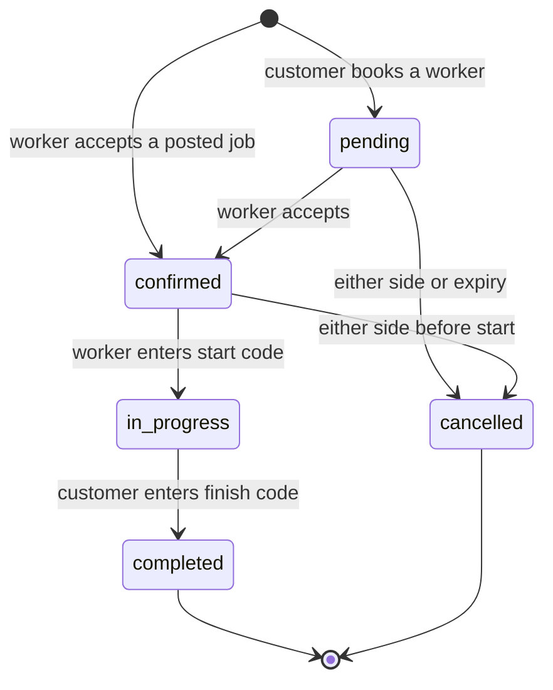
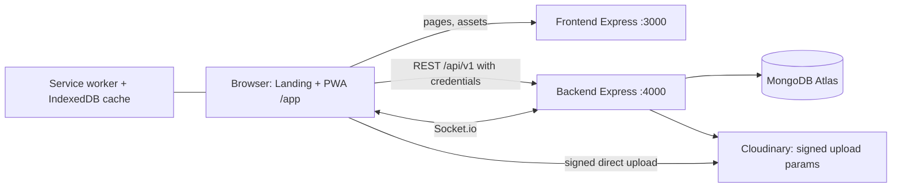

# WorkCred: Complete Project Plan

**Tagline:** Proof of work, work near you.
**Version:** 3.2 (local build) · **Date:** 16 Oct 2026
**Document type:** Product Requirements (PRD) + Technical Plan

---

## 0. What changed in v3.2
- **Decision A (Scope Reduction):** Removed secondary alert collections, endpoints, socket events, and UI components. Refactored real-time to active socket state updates with REST re-fetch on connect/focus. Tab counts represent actionable items directly from booking list data.
- **Decision B (Identity Consistency):** Standardized on email + password for authentication across all sections, tables, and schemas. Phone is a required 10-digit contact field, not unique, and never a login credential.
- **Decision C (Navigation Finalization):** Standardized navigation tab names exactly per Design System: Customer (`Find`, `Free now`, `Post job`, `Bookings`, `Saved`), Worker (`Home`, `My work`, `Passport`, `Post`, `Me`). Customer account lives behind header initials button; worker account lives inside `Me`.
- **Decision D (Weekly Calendar):** Explicitly noted that worker weekly calendar represents weekday row selection opening a choice sheet for the 5 states (Off, Morning, Afternoon, Evening, Full day).
- **Decision E (Core Logic Clarifications):**
  - E1: Profile completeness criteria computed server-side on save.
  - E2: Contact info blocking rules (`containsContactInfo`) with normalization and regex heuristics.
  - E3: Start location coordinates logic (null coordinates succeed without warning; >500m sets `farFromJob: true`).
  - E4: Free Now expiry evaluated at read-time against injectable clock module.
  - E5: Fair Rate Compass 3-tier fallback (localityKey -> cityKey -> sample baseline).

---

## 1. Product Overview

### 1.1 One-line pitch
WorkCred is a mobile-first web app where daily-wage workers build a verified work history and get hired nearby at fair prices, and customers find trusted help fast, with cash paid directly and no middleman.

### 1.2 The problem
| Who | Pain |
|---|---|
| Workers (helpers, electricians, plumbers, masons, painters, cooks, cleaners, drivers, vendors) | No proof of past work, so every new customer starts from zero. Idle hours lose income. They do not know what to charge. Middlemen and unreliable apps take a cut. |
| Customers (households, shops, small contractors) | Hard to find trustworthy help quickly. No way to check a worker's real history. Prices are opaque. No-shows are common. |
| Both | Cash jobs have no evidence of who showed up, how long they worked, or whether the job was finished. |

### 1.3 The solution
1. **Verified work records.** A job is recorded only when both people complete a two-code handshake (a start code and a finish code). Each record is added to the worker's **Work Passport**, a tamper-evident history.
2. **Real-time availability.** Workers tap "I'm Free Now" for 2, 4 or 8 hours and nearby customers see them instantly.
3. **Price transparency.** The **Fair Rate Compass** shows the normal price range for a skill in an area.
4. **Simple cash flow.** The app handles matching, scheduling and proof. Money is paid in cash after the job, so there is no wallet, no commission and no payment gateway.
5. **Light community layer.** A nearby feed with work photos, follow/save and skill endorsements, with no chat and no public comments.

### 1.4 Scope of this version
- Runs entirely on one computer (localhost), with the database on MongoDB Atlas (free tier) and photos on Cloudinary.
- Built as two separate Express servers: a frontend server and a backend API server.
- Private by default: all worker and customer information is visible only to logged-in users inside the app. There are no public profile pages and no external sharing in this version.

### 1.5 Vision and value
| For workers | For customers |
|---|---|
| Portable proof of work and rating | Hire with evidence, not guesses |
| More paid hours through Free Now | Find help within minutes |
| Know a fair price before bidding | See the fair price before booking |
| Keep 100% of cash earned | Pay the worker directly, no surcharge |

---

## 2. Users and Personas

| Persona | Description | Main goals | Constraints |
|---|---|---|---|
| **Worker: Ravi, 34, electrician** | Low-end Android phone, patchy mobile data, uses simple English or his regional language | Get steady jobs nearby, show a track record, charge fairly | Limited typing, small screen, may be outdoors in bright light |
| **Worker: Lakshmi, 41, domestic helper** | Shares a phone with family, works several homes | Get regular bookings, prove reliability | Time-poor, needs very simple flows |
| **Customer: Meera, 29, working professional** | Smartphone user, books help for home repairs | Find a trusted electrician or helper fast | Worried about safety and being overcharged |
| **Customer: Imran, 45, small shop owner** | Needs 2 helpers for a few hours at short notice | Fill urgent shifts quickly | Needs Free Now and quick booking |
| **Support/Admin (developer only)** | Maintains the system | Reset a password, unlock an account, review flagged items | Uses scripts, not a UI, in this version |

---

## 3. Goals, Non-Goals and Success Measures

### 3.1 Goals
1. A worker can sign up and be ready for work in under 3 minutes.
2. A customer can find a worker and send a booking request in under 2 minutes.
3. Every completed job produces exactly one tamper-evident Passport record.
4. A cash job can be completed with clear evidence of who was present and for how long.
5. Works on low-end phones and weak networks, and installs as an app from the browser.
6. Private data (phone numbers, exact locations, codes) is released only when needed.

### 3.2 Non-goals for this version
Online payments or wallets, chat, public profile pages, external sharing, video, a map view, admin dashboards, real SMS or email, background alerts or auxiliary inboxes, multiple languages (the UI is in plain English with all strings in one file so other languages can be added later), and cloud hosting.

### 3.3 Success measures (how we will judge the project)
| Area | Measure |
|---|---|
| Core flow | A full journey (sign up, search, book, confirm, start code, finish code, receipt, Passport entry) works end to end in a demo in under 7 minutes |
| Integrity | Changing any stored record is detected by the integrity check 100% of the time in tests |
| Concurrency | Parallel tests show no double-booking, no oversold jobs and no more than 5 code attempts counted |
| Performance | Lighthouse mobile: Performance 90+, Accessibility 95+, Best Practices 95+ on main screens (Slow 4G, 4x CPU) |
| Quality | All automated tests pass (unit, backend, end-to-end, accessibility); zero Critical or High security findings open |
| Honesty | The app and docs make no claim that is not true of the build (no invented statistics, testimonials or verification claims) |

---

## 4. Product Principles
1. **Trust comes from evidence, not claims.** Proof is created by the handshake, not typed in by users.
2. **Simple English, one action per screen.** Short words ("Find Worker", "I'm Free", "Job Done", "Paid Cash"), icon plus label on every button, 16 px minimum text, 48 px minimum tap targets.
3. **Cash-first.** The app never touches money.
4. **Private by default.** Phone numbers, exact locations and booking codes are shown only to the right person at the right time.
5. **Calm, human design.** Warm and professional, not flashy. Meaning is never shown by color alone.
6. **Works on weak phones and networks.** Small JavaScript, cached screens, clear offline states.
7. **Honest by design.** Sample data is labeled as sample. Limitations are documented.

---

## 5. Roles and Permissions

Role is chosen at sign-up and cannot be changed. `admin` is never created through the app.

| Capability | Visitor | Customer | Worker |
|---|---|---|---|
| View landing, privacy, terms | ✔ | ✔ | ✔ |
| Sign up, log in | ✔ | n/a | n/a |
| Search workers, view profiles and Passport history | ✘ | ✔ | ✔ (view only) |
| Post jobs, book workers, finish jobs with the finish code, rate, endorse | ✘ | ✔ | ✘ |
| See open jobs, accept jobs, confirm requests, enter start code, go Free Now | ✘ | ✘ | ✔ |
| Create work posts, manage Passport privacy, edit skills, rate and calendar | ✘ | ✘ | ✔ |
| Save, follow, report, feed, change password | ✘ | ✔ | ✔ |

---

## 6. Features and Functional Requirements

Priority: **M** = must have (MVP), **S** = should have, **L** = later (Phase 2).

### 6.1 Authentication and accounts (M)
| ID | Requirement |
|---|---|
| AUTH-1 | **Sign up** with role (worker or customer), name, email, 10-digit Indian mobile number (contact only, not unique) and password. Email is unique and normalized to lowercase. |
| AUTH-2 | **Log in** with email and password using role tabs (Worker, Customer). The role is checked only after the password is verified. A mismatched role returns a clear message and no session. Responses for unknown email and wrong password are identical ("Email or password is wrong."). |
| AUTH-3 | **Password rules:** 8 to 64 characters, not a common password, not the phone number, not the name, not the email prefix, no repeated or sequential patterns. Passwords are hashed with scrypt and per-user salt, never stored or logged in plain form. |
| AUTH-4 | **Brute-force protection:** after 5 wrong passwords the account locks for 10 minutes (doubling up to 1 hour). Per-IP limits on sign-up and login. |
| AUTH-5 | **Sessions:** 15-minute access token held in memory only, plus a rotating 30-day refresh cookie (`wc_rt`, httpOnly, SameSite=Lax, Path=/api/v1/auth). Reuse of an old refresh token revokes that token family. Silent refresh keeps users logged in. |
| AUTH-6 | **Change password** (needs the current password). Increments `tokenVersion` so all other devices are logged out. |
| AUTH-7 | **Log out** revokes the session cookie and clears cached data. Other open tabs also log out. |
| AUTH-8 | **Password reset** is handled by support through a script (no email or SMS in this version). The login screen says so plainly. |
| AUTH-9 | Disabled accounts cannot log in or keep a session. |

### 6.2 Onboarding and profiles (M)
| ID | Requirement |
|---|---|
| PROF-1 | **Worker onboarding:** name, phone (required contact, not unique), optional photo, 1 to 6 skills (one marked main), rate per hour or day (greater than 0), area (`localityKey`), job-search radius (1 to 10 km), short bio (optional, 200 characters max). |
| PROF-2 | **Customer onboarding:** name, phone (required contact, not unique) and area (`localityKey`). |
| PROF-3 | Skills list: helper, electrician, plumber, mason, painter, carpenter, cook, cleaner, driver, vendor, other. |
| PROF-4 | **Availability calendar** for workers: weekly pattern (Off, Morning, Afternoon, Evening, Full day per weekday) plus blocked dates. Customers cannot book blocked slots. The UI displays seven weekday rows opening a choice sheet per design system section 9.9. |
| PROF-5 | Profile photos are compressed in the browser and uploaded directly to Cloudinary with a server-signed request. |
| PROF-6 | **Profile completeness (computed server-side on every profile save, never sent by client):** Worker complete when: name, phone, at least 1 skill with exactly one marked main, a rate (hourly or daily, > 0), an area (`localityKey`), and a search radius (1 to 10 km). Photo and bio are optional. Customer complete when: name, phone, and area (`localityKey`). Incomplete profiles route to onboarding. |

### 6.3 Find workers (M)
| ID | Requirement |
|---|---|
| FIND-1 | Search by skill, distance (1 to 10 km), price range (per hour or per day), minimum rating. Sort by nearest, top rated or lowest price. |
| FIND-2 | Worker cards show photo or initials, name, main skill, rating and job count, **approximate** distance ("about 1 km"), rate with a Fair/Low/High chip, a "Has verified history" badge (when the worker has Passport records) and a "Free now" badge when live. |
| FIND-3 | Filters are kept in the URL so back and refresh work. Results use cursor pagination with no duplicates. |
| FIND-4 | Phone numbers, emails, and exact coordinates are never returned in search results. |

### 6.4 Worker profile (M)
| ID | Requirement |
|---|---|
| WPRO-1 | Shows bio, skills, rate, stats (jobs, rating, hours), a seven-day availability summary and endorsement counts per skill. |
| WPRO-2 | Shows the worker's **visible Passport records** (see 6.8) with the integrity check result ("History checked: Valid, N records"). |
| WPRO-3 | Actions: Book, Save, Follow, Endorse (only after a completed job with that worker for that skill), Report. |
| WPRO-4 | The phone number is not shown. A **Call** button appears only on a confirmed or in-progress booking. |

### 6.5 Jobs (M)
| ID | Requirement |
|---|---|
| JOB-1 | A customer posts a job: skill, workers needed (1 to 10), hours (1 to 12), start date and time (future, within 30 days), offered rate per worker, description (300 characters), location. |
| JOB-2 | While posting, the customer sees the **Fair Price hint** (Low, Fair or High) from the Compass. |
| JOB-3 | Nearby workers with a matching skill see the job in **Jobs near you** with approximate distance, pay, spots left and start time. |
| JOB-4 | A worker accepts a job. Slot counting is atomic, so a job with 2 slots can never get 3 workers. When full the job becomes "filled". |
| JOB-5 | A worker cannot accept overlapping work or work on a blocked day. |
| JOB-6 | A customer can cancel a job. Bookings that have not started are cancelled and workers see the update in their booking list. |
| JOB-7 | Jobs expire after their start time. |

### 6.6 Direct booking (M)
| ID | Requirement |
|---|---|
| BOOK-1 | A customer books a specific worker: date, time, hours (1 to 12), optional note (200 characters). The booking starts as **pending**. |
| BOOK-2 | The worker accepts (confirmed) or declines. Pending bookings also block the worker's time so two customers cannot grab the same slot. |
| BOOK-3 | Booking requests from the Free Now list start in 30 minutes by default. |
| BOOK-4 | **Contact blocking:** Captions, notes, descriptions, and reports cannot contain phone numbers, emails, or links (including disguised forms). Enforced via shared pure function `containsContactInfo(text)`: normalizes to lowercase, Unicode NFKC, maps Devanagari/Malayalam digits to 0-9, strips inter-digit punctuation, and blocks runs of 7+ digits, 6+ spelled-out numbers, email/URL patterns, or social media handles followed by numbers. Operational phrases ("2 workers for 4 hours", "Rs 1,200", "3 PM to 6 PM", "12/10/2026", "room 204") are preserved. |
| BOOK-5 | Submitting twice (slow network, double tap) never creates two bookings (idempotency key). |

### 6.7 Handshake and cash payment (M), the core trust feature
| ID | Requirement |
|---|---|
| HAND-1 | Each booking gets a 4-digit **start code** and a 4-digit **finish code** at creation, stored encrypted with AES-256-GCM. Only the customer can see them, and only while the booking is confirmed or in progress. They are hidden until tapped and auto-hide after 30 seconds. |
| HAND-2 | **Start:** the worker arrives, asks the customer for the start code and enters it with optional GPS location. Start location evaluation: if no coordinates sent, start succeeds, no warning, `startedGeo = null`, `farFromJob = null` (unknown). If valid coordinates within 500 m (haversine), succeed with `farFromJob = false`. If valid coordinates beyond 500 m, succeed with soft warning and `farFromJob = true`. Invalid coordinates return a 400 error. The booking becomes **in progress** and start time is recorded. |
| HAND-3 | **Finish:** the customer enters the finish code, confirms "I paid cash" and rates the worker from 1 to 5 with an optional comment. The booking becomes **completed**. |
| HAND-4 | Five wrong code attempts lock that step for 10 minutes. Attempt counting is atomic. |
| HAND-5 | Finishing runs in one database transaction: it completes the booking, creates the Passport record and updates the worker's stats. After that the Compass data is recomputed. |
| HAND-6 | Bookings can be cancelled by either side only before the start. Repeated worker cancellations are counted and warned about. |
| HAND-7 | **Receipt** for both sides: date, times, hours, cash amount, rating and the new Record ID. |
| HAND-8 | The worker's phone number and the exact job location are released to the other side only when the booking is confirmed. |
| HAND-9 | "Report a problem" lets a worker flag an issue during a job (stored for support). |

### 6.8 Work Passport (M), in-app verified history
| ID | Requirement |
|---|---|
| PASS-1 | Each completed job adds exactly one **Passport record**: skill, date, hours, rating, comment, employer display name, Record ID. |
| PASS-2 | Records are **append-only**. Nothing in the app can edit or delete a record. Workers can only change two things per record: whether it is **visible to customers**, and whether the **employer name is shown or masked** (default masked, for example "R*** K."). Toggling visibility or masking never breaks the cryptographic hash chain. |
| PASS-3 | Records are chained: each record's fingerprint includes the previous one. The system also stores the latest record number and fingerprint on the worker, so deleted tail records are detected. |
| PASS-4 | **Integrity check:** recomputes the full chain, including private records, and reports "Valid, N records" or "Needs attention" without exposing any fingerprints. Runs server-side. |
| PASS-5 | Worker's **Passport tab**: stats, skill counts, full timeline (including hidden records), privacy controls, integrity strip, and a "Show or hide" summary ("12 shown, 2 hidden"). New workers see a friendly empty state. |
| PASS-6 | Customers see only visible records on the worker profile, with masked employer names and a note such as "2 private records are included in the check". |
| PASS-7 | The language is plain English ("History checked", "Valid", "Records checked"). No technical jargon such as blockchain, crypto or hash appears in the UI. |

### 6.9 Free Now Radar (M)
| ID | Requirement |
|---|---|
| FREE-1 | A worker taps **I'm Free Now** and picks 2, 4 or 8 hours. One live window per worker. The card shows a countdown, Extend (up to 12 hours total) and Stop. |
| FREE-2 | Customers see a distance-sorted list of workers free within 3 km (up to 5 km) with minutes left, rate, rating and a **Book now** button. |
| FREE-3 | Lists update live when workers go free or get booked. If the live connection drops, the list refreshes every 30 seconds. |
| FREE-4 | **Read-time expiry:** Expired windows disappear immediately by filtering `{ expiresAt: { $gt: now } }` at query time (where `now` comes from an injectable clock module for test determinism), not relying on database TTL cleanup. |
| FREE-5 | A worker with a job in progress cannot go Free Now. Booking a free worker or starting a job closes the window. |

### 6.10 Fair Rate Compass (M)
| ID | Requirement |
|---|---|
| COMP-1 | Shows the 25th percentile, median and 75th percentile price per skill per area (per hour or per day) from completed jobs of the last 90 days. |
| COMP-2 | **3-Tier Fallback:** If fewer than 5 samples exist for skill + `localityKey`, falls back to skill + `cityKey`. If still fewer than 5 samples, falls back to the sample baseline data for that skill and displays "Based on sample rates for now". |
| COMP-3 | Appears on Post Job, the worker's rate editor, worker cards and the booking sheet as a Low, Fair or High bar with an icon and label. |

### 6.11 Feed, posts, follow and endorse (S)
| ID | Requirement |
|---|---|
| FEED-1 | One feed screen for both roles. Workers see nearby open jobs and work posts. Customers see free workers and work posts. Both see posts from followed workers. Cursor pagination, no duplicates. |
| FEED-2 | **Work posts:** an after photo (required), an optional before photo, skill, caption (140 characters) and an optional link to a completed job (shows a "Verified job" badge). Limits: 10 posts per day. |
| FEED-3 | **Follow and Save** workers. Lists with undo. |
| FEED-4 | **Endorse** a worker's skill once, only after a completed job for that skill. |
| FEED-5 | **Report** a post or worker. Reports are stored only, with duplicate suppression and rate limits. |
| FEED-6 | There is no chat, no public comments and no likes. Contact happens through the Call button after confirmation. |

### 6.12 Realtime (M)
- While the app is open, booking and job updates arrive over the Socket.io connection and update the screen live without reload.
- A user who was offline or away sees the ground truth when they open the app or when the socket reconnects: the client automatically refetches lists. Nothing is lost because booking and job lists are the single source of truth.
- Tab labels carry actionable counts as text:
  - Worker: `My work (2)` when booking requests need an answer.
  - Customer: `Bookings (1)` when bookings need customer action (e.g. ready to provide start code or finish code).
  - Counts are derived directly from booking query data, not an inbox collection.
- Worker Home displays the **"Needs your answer"** section at the top.
- App Header: Customers show the initials account button only; workers show no action icons on the right.

### 6.13 Offline and install (S)
Installable PWA. App shell works offline. Whitelisted screens (profile, lists, Passport, feed) show a "Saved copy from {time}" banner. Actions that need a live connection are disabled with a plain message. Only save and follow actions are queued offline. Booking codes are never cached.

### 6.14 Landing page (M)
A public marketing page that opens first at `/`. See section 9.

### 6.15 Phase 2 (L)
| Feature | Idea |
|---|---|
| Background alerts | App alerts center and device alerts |
| Phone verification | Optional OTP "verify my number" step |
| Password reset | Self-service by SMS or email |
| Income Proof Statement | A private PDF of verified earnings for loans and rent |
| Squad Jobs | Book a crew as one unit, split payout |
| Skill Levels | Beginner, Trusted, Expert from completed jobs and endorsements |
| More languages | Regional language UI |
| Admin console | Review reports and flagged items |
| Hosting | Move from localhost to the cloud |

---

## 7. User Flows

### 7.1 Customer journey
1. Landing page → **Sign up** as a customer (name, email, phone, password) → onboarding (locality).
2. **Find** workers, or open **Free now**, or **Post job** (with the Fair Price hint).
3. Open a worker profile, check their history, **Book**.
4. The worker confirms. The booking detail now shows the worker's phone, the exact job location and the codes.
5. On the day the worker arrives and the customer reads out the **start code**.
6. When done the customer enters the **finish code**, confirms "I paid cash" and rates.
7. Receipt appears and the Passport gains a record. The customer can endorse the worker.

### 7.2 Worker journey
1. Landing page → **Sign up** as a worker (name, email, phone, password) → onboarding (skills, rate, area, radius).
2. **Home:** tap I'm Free Now, answer booking requests in "Needs your answer", or accept jobs near you.
3. **My work:** see requests and confirmed jobs. On arrival tap "I've arrived" and enter the customer's start code.
4. Do the job. The customer finishes it.
5. See "Job done, ₹X earned" and the new record in the **Passport** tab. Adjust privacy.
6. Share work photos in **Post** and keep the calendar and rate current in **Me**.

### 7.3 Booking state diagram

---

## 8. Screen Inventory

### 8.1 Public
Landing (`/`), Sign up, Log in, Privacy, Terms, Grievance (drafts for legal review).

### 8.2 Shared (logged in)
Onboarding, Feed, Account (profile summary, edit, change password, log out), Report sheet, 404, Offline and error states.

### 8.3 Customer app (bottom tabs: Find · Free now · Post job · Bookings · Saved)
| Screen | Notes |
|---|---|
| Find, Filters sheet, Locality picker | Search and sort |
| Worker profile | Passport preview, integrity badge, Book, Save, Follow, Endorse |
| Booking sheet | Day and time chips, hours, price summary, Compass bar |
| Free now | Live list with Book now |
| Post job | Form, Fair Price card, review, success |
| Bookings | Tabs: Upcoming, Active, Done, plus My jobs. Header badge shows action items |
| Booking detail | Timeline, codes (tap to reveal), Call, cancel |
| Finish sheet | Code, paid cash, rating, comment |
| Receipt | Summary and Record ID |
| Saved | Saved and Following tabs |

### 8.4 Worker app (bottom tabs: Home · My work · Passport · Post · Me)
| Screen | Notes |
|---|---|
| Home | Free now card, "Needs your answer" requests, Jobs near you |
| Job detail sheet | Accept job |
| My work | Tabs: Requests, Upcoming, Active, Done. Tab label shows pending count e.g. "My work (2)" |
| Booking detail | Timeline, Call, directions after confirmation, cash to collect |
| Start code sheet | Four boxes, location check, attempts left |
| Active job view | Timer, Report a problem |
| Completion sheet and Receipt | Earnings and new record |
| Passport | Stats, timeline, privacy toggles, integrity strip, entry detail sheet |
| Post | Create work post, My posts |
| Me | Profile, skills, rate editor with Compass, calendar (weekday rows) and blocked dates, radius, account |

---

## 9. Design and UX

### 9.1 Design system: "WorkCred Warm"
| Element | Rule |
|---|---|
| Canvas | Warm cream pages, slightly deeper cream bands for alternate sections |
| Dark surfaces | Espresso brown-black for emphasis sections and the footer |
| Accent | Terracotta for primary buttons, eyebrow labels and one italic accent word per headline |
| Status | Forest green for live, success and verified, always with an icon and label. Amber for caution, red for errors |
| Type | Serif display headings (Newsreader) with clean sans-serif (Plus Jakarta Sans) for body/UI. Monospace for identifiers |
| Shape | Hairline borders, soft radius (cards, calm inputs, pill buttons), few shadows |
| Navigation | Floating pill bottom tab bar on mobile with icon and label |
| Tokens | All colors, sizes, spacing and motion live in `frontend/css/tokens.css` |

### 9.2 Accessibility and usability rules
48 px tap targets, 16 px minimum body text, 13 px minimum labels, WCAG AA contrast, visible focus rings, keyboard operable everything, focus moves to page heading on route change, sheets trap and restore focus, screen-reader live regions for status changes, works at 200% zoom and with 30% longer text, respects reduced motion and data saver.

---

## 10. System Architecture

### 10.1 Two separate Express servers
| | Frontend server | Backend server |
|---|---|---|
| Address | `http://localhost:3000` | `http://localhost:4000` |
| Role | Serves the landing page, `/app` (single-page app), static assets, shared rule modules and `/config.js` | REST API at `/api/v1` and Socket.io server |
| Stack | Express, helmet, compression | Express, Mongoose, Socket.io and security middleware |
| Data | None | MongoDB Atlas, Cloudinary |

The browser loads pages from port 3000 and calls the API on port 4000 directly with credentials. Ports 3000 and 4000 on the same hostname share same-site cookie context.

### 10.2 Backend structure (modular monolith)
Routes → Controllers → Services → Models → MongoDB. Business rules live in services and in a `shared/` folder of pure modules (state machine, hash chain, Compass math, geo helpers, validators, password rules, contact blocking) used by both mock and backend.

---

## 11. Technology Stack

| Layer | Technology | Why |
|---|---|---|
| Frontend | HTML, CSS, vanilla JavaScript (ES modules) | Required stack, tiny bundles for low-end phones, no build step |
| Frontend server | Node.js 20+ Express + helmet + compression | Simple static hosting with security headers and CSP |
| Backend | Node.js 20+ Express 4 | Required stack, mature middleware, native ESM |
| Database | MongoDB Atlas (free M0) + Mongoose 8 | Required stack, geo queries, TTL indexes, transactions |
| Authentication | Email + password (scrypt via `node:crypto`), JWT access token (`jose`), rotating refresh cookie (`wc_rt`) | Standard, secure local auth without external gateways |
| Real-time | Socket.io | Live job/booking updates and Free Now radar |
| Media | Cloudinary (signed direct uploads) | Offloads image storage and optimization |
| Offline | Service worker + IndexedDB | PWA install and cached screens |
| Testing | `node:test`, mongodb-memory-server, Playwright and axe-core | Full coverage across units, integration, E2E, accessibility |

---

## 12. Data Model (MongoDB)

All primary IDs are ObjectIds. Geo fields are GeoJSON points `[lng, lat]`.

| Collection | Key fields | Indexes |
|---|---|---|
| **users** | email (unique), phone (not unique), role (fixed), name, passwordHash, failedLoginCount, lockUntil, lockLevel, tokenVersion, skills, rates, bio, area, calendar, passportStats, passportHead, profileComplete | `{ email: 1 }` (unique); `2dsphere location`; `{ role: 1, isActive: 1, skills: 1 }` |
| **refreshTokens** | userId, familyId, tokenHash, usedAt, replacedByHash, revokedAt, expiresAt | `{ tokenHash: 1 }` (unique); `{ expiresAt: 1 }` (TTL) |
| **jobs** | customerId, skill, workersNeeded, acceptedCount, hours, startAt, offeredRate, description, location, localityKey, status | `2dsphere location`; `{ status: 1, skill: 1, startAt: 1 }` |
| **bookings** | customerId, workerId, jobId?, skill, agreedRate, scheduledAt, hours, status, startCodeEnc, finishCodeEnc, attempts, startedAt, startedGeo, farFromJob, finishedAt, hoursWorked, paidCash, rating, comment | `{ workerId: 1, status: 1, scheduledAt: 1 }`; `{ customerId: 1, status: 1, scheduledAt: 1 }` |
| **passportEntries** | workerId, bookingId, seq, skill, date, hours, rating, comment, employerName (private), employerDisplay {name, masked}, maskEmployerName, visible, prevHash, hash | `{ bookingId: 1 }` (unique); `{ workerId: 1, seq: 1 }` (unique); `{ workerId: 1, visible: 1, seq: -1 }` |
| **availability** | workerId, location, skills, rate, startsAt, expiresAt, active | `2dsphere location`; `{ expiresAt: 1 }` (TTL); `{ workerId: 1, active: 1 }` |
| **rateStats** | skill, localityKey, cityKey, p25, median, p75, sampleSize, isSeed | `{ skill: 1, localityKey: 1 }` (unique) |
| **posts** | workerId, skill, caption, afterUrl, beforeUrl, bookingId?, verifiedJob, location | `{ createdAt: -1, _id: -1 }`; `2dsphere location`; `{ bookingId: 1 }` (unique, sparse) |
| **follows** | fromId, toId, type ('follow' \| 'save') | `{ fromId: 1, toId: 1, type: 1 }` (unique) |
| **endorsements** | customerId, workerId, skill | `{ customerId: 1, workerId: 1, skill: 1 }` (unique) |
| **reports** | targetType, targetId, reason, note, reporterId, ipHash | `{ targetType: 1, targetId: 1 }`; `{ createdAt: -1 }` |
| **idempotencyKeys** | userId, key, route, responseSnapshot | `{ userId: 1, key: 1, route: 1 }` (unique); `{ createdAt: 1 }` (TTL 24h) |

---

## 13. API Overview (`/api/v1`)

Standard responses: `{ "success": true, "data": {}, "message": "" }` and `{ "success": false, "error": { "code": "...", "message": "..." } }`.

| Area | Endpoints | Who |
|---|---|---|
| Auth | `POST /auth/signup`, `POST /auth/login`, `POST /auth/refresh`, `POST /auth/logout`, `POST /auth/password/change` | Public / Logged in |
| Users | `GET /users/me`, `PATCH /users/me` | Logged in |
| Workers | `GET /workers`, `GET /workers/:id`, `GET /workers/:id/passport`, `GET /workers/:id/passport/verify` | Logged in |
| Jobs | `POST /jobs`, `GET /jobs`, `GET /jobs/mine`, `POST /jobs/:id/accept`, `POST /jobs/:id/cancel` | Role-checked |
| Bookings | `POST /bookings`, `GET /bookings`, `GET /bookings/:id`, `POST /bookings/:id/confirm`, `/start`, `/finish`, `/cancel`, `/report` | Role-checked, participants only |
| Passport | `GET /passport/me`, `PATCH /passport/entries/:id` (visibility and mask flag only) | Worker |
| Free Now | `GET /availability/me`, `POST /availability`, `DELETE /availability`, `GET /availability/nearby` | Worker writes, customer reads |
| Compass | `GET /compass` | Logged in |
| Feed | `GET /feed`, `POST /posts`, `GET /posts/mine`, `DELETE /posts/:id`, `POST /follows`, `DELETE /follows/:toId`, `GET /follows`, `POST /endorsements` | Role-checked |
| Uploads | `POST /uploads/sign` | Logged in |
| Reports | `POST /reports` | Logged in |
| Health | `GET /health`, `GET /health/ready` | Public |

---

## 14. Real-Time Events (Socket.io)

Socket connection authenticates with JWT in the handshake auth payload.
- `job:new`, `job:filled`
- `radar:worker_free`, `radar:worker_busy`
- `booking:request`, `booking:created`, `booking:started`, `booking:completed`, `booking:cancelled`

---

## 15. Security, Privacy and Integrity

See [docs/SECURITY_SPEC.md](file:///c:/Users/mibin/OneDrive/Desktop/WorkCred/docs/SECURITY_SPEC.md) for full cryptographic details, AES-256-GCM scheme, test vectors, and exact normalization parameters.

---

## 16. Business Rules and Limits

| Rule | Value |
|---|---|
| Password | 8 to 64 characters, common and personal-info passwords rejected |
| Login lock | 5 wrong passwords → 10 minutes, doubling to 1 hour |
| Sign-up limit | 5 per hour and 20 per day per IP |
| Login limit | 20 attempts per 10 minutes per IP |
| Access token / refresh cookie | 15 minutes / 30 days (90-day absolute session maximum) |
| Job | 1 to 10 workers, 1 to 12 hours, starts within 30 days, 20 posts per customer per day |
| Booking | 1 to 12 hours, 20 requests per customer per hour, pending bookings block the slot |
| Code attempts | 5 wrong tries → locked 10 minutes (separate counters for start and finish) |
| Start location warning | More than 500 m from job location (warning only; null coordinates proceed cleanly) |
| Free Now | 2, 4 or 8 hours, extend to 12 hours total, default radius 3 km (max 5), 20 changes per hour |
| Search radius | Up to 10 km |
| Compass | 90-day window, at least 5 samples (locality -> city -> baseline) |
| Posts | 10 per day per worker, 100 active, caption 140 characters (contact info blocked) |
| Follows and saves | 500 each |
| Uploads | 5 MB, JPEG, PNG or WebP, resized to 1280 px, 20 signed uploads per hour |
| Idempotency keys | Kept for 24 hours |

---

## 17. Delivery Roadmap

| Major Phase | Sub-phases & Milestones | Deliverable |
|---|---|---|
| **Phase 1: System Design** | Phase 1 (Docs pack, specs, review) | Foundation docs, contracts, security spec |
| **Phase 2: Backend** | B1 (Express & Atlas), B2 (Models), B3 (Auth), B4 (Jobs & Bookings), B5 (Handshake codes), B6 (Passport & Integrity), B7 (Compass & Free Now) | Complete REST & Socket API |
| **Phase 3: Seed Data** | Realistic local demo accounts, Kochi localities, sample baseline compass data | Reliable demo database |
| **Phase 4: Frontend Integration** | S1 (Shared pure modules), I1 (Tokens), I2 (Landing & Auth), I3 (Customer flows), I4 (Worker flows), I5 (Passport & Receipt), I6 (Social & PWA) | Integrated PWA client |
| **Phase 5: Branding and Polish** | P1 (Brand SVGs, Favicon, Typography, Motion polish) | Premium bespoke aesthetic |
| **Phase 6: Debug and Fix** | End-to-end integration debugging, accessibility fixes, contract parity | Defect-free user journeys |
| **Phase 7: Hardening** | D1 (Concurrency, security audit, abuse tests), H1 (Local launch readiness & demo script) | Production-grade local demo |
